# TaskFlow Allocator — Engineering Task Assignment & Schedule Management

<p align="center">
  <svg width="128" height="128" viewBox="0 0 128 128" fill="none" xmlns="http://www.w3.org/2000/svg">
    <rect width="128" height="128" rx="28" fill="#0F172A"/>
    <rect x="24" y="24" width="22" height="80" rx="6" fill="#38BDF8"/>
    <rect x="53" y="40" width="22" height="64" rx="6" fill="#F59E0B"/>
    <rect x="82" y="56" width="22" height="48" rx="6" fill="#10B981"/>
    <circle cx="35" cy="36" r="3.5" fill="#FFFFFF"/>
    <circle cx="64" cy="52" r="3.5" fill="#FFFFFF"/>
    <circle cx="93" cy="68" r="3.5" fill="#FFFFFF"/>
  </svg>
</p>

<p align="center">
  <strong>Universal Offline-First Progressive Web App (PWA) for Industrial SCADA Operations</strong><br>
  <em>Customized for Al Gurg Automation and Controls — Dubai, U.A.E.</em>
</p>

<p align="center">
  
  
  
  
  
</p>

---

## 📌 1. Project Purpose & Operational Scope

**TaskFlow Allocator** directly executes **Job Responsibility #19** for the SCADA Engineering department at **Al Gurg Automation and Controls (Dubai, U.A.E.)**:
> *"Assign tasks to internal teams and assist with schedule management. Make sure that clients’ needs are met."*

The application bridges contractual project deliverables from major UAE public utilities and industrial clients (such as **DEWA**, **ADNOC**, **Dubai Municipality**, and **JAFZA**) directly to internal technical discipline engineering teams, providing proactive capacity balancing, schedule conflict prevention, and SLA milestone verification.

### Core Lifecycle Flow

```
┌─────────────────────────┐       ┌───────────────────────────┐       ┌────────────────────────┐       ┌────────────────────────┐
│  4. Client Needs        │ ───▶  │   + Assign New Task       │ ───▶  │  2. Team Load          │ ───▶  │  1. Kanban Board       │
│  (SLA & Milestone Sync) │       │  (Smart Best-Fit Matcher) │       │  (Capacity & UAE Shift)│       │  & 3. Gantt Scheduler  │
└─────────────────────────┘       └───────────────────────────┘       └────────────────────────┘       └────────────────────────┘
```

---

## 🏗️ 2. System Architecture

The application is built as an offline-first Single Page Application (SPA / PWA) utilizing an asynchronous, indexed transactional storage layer and responsive UI view controllers.

```mermaid
graph TB
    subgraph UI_Layer ["Presentation & View Controllers"]
        KPI["Executive KPI Header<br/>(Adherence %, Utilization %, Blockers, SLAs)"]
        Tab1["1. Kanban Engine<br/>(Drag-and-Drop, Fast Move, WIP Limits)"]
        Tab2["2. Team Allocation Matrix<br/>(Capacity Tracking, UAE Shift Engine)"]
        Tab3["3. Interactive Scheduler<br/>(Gantt Timeline, Site Rosters, Shift Engine)"]
        Tab4["4. Client Needs Tracker<br/>(Deliverable Tracing & Formal Sign-offs)"]
    end

    subgraph Controller_Layer ["Business Logic & Coordination"]
        AppController["Main Controller (app.js)"]
        SmartAllocator["Smart Auto-Allocator Engine"]
        ConflictEngine["Conflict & Overload Detector"]
        ExportEngine["Local Disk Sync & File System Access API"]
    end

    subgraph PWA_Layer ["Service Worker & Native Integration"]
        SW["Service Worker (sw.js)"]
        CacheStore["Cache Storage API<br/>(App Shell & Dynamic Assets)"]
        StaticRoute["Safari / Chromium Static Routing API"]
        NativeAPIs["Badging API, Web Share & WCO"]
    end

    subgraph Storage_Layer ["Persistence Engine (TaskFlowAllocatorDB)"]
        IDB[(IndexedDB Multi-Store)]
        store_tasks["tasks"]
        store_team["team_members"]
        store_clients["client_requirements"]
        store_schedule["schedule_events"]
        store_audit["audit_history"]
        store_archive["archived_records (Cold Storage)"]
        store_sync["sync_queue (Mutation Log)"]
    end

    KPI --> AppController
    Tab1 <--> AppController
    Tab2 <--> AppController
    Tab3 <--> AppController
    Tab4 <--> AppController

    AppController --> SmartAllocator
    AppController --> ConflictEngine
    AppController --> ExportEngine

    AppController <--> IDB
    IDB --- store_tasks
    IDB --- store_team
    IDB --- store_clients
    IDB --- store_schedule
    IDB --- store_audit
    IDB --- store_archive
    IDB --- store_sync

    SW <--> CacheStore
    SW <--> StaticRoute
    SW <--> NativeAPIs
    AppController <--> SW
```



---

## ⚙️ 3. Core Modules & Engineering Features

### 1. Interactive Engineering Kanban Board
* **6 Workflow Stages**:
  1. `Client Spec & Backlog`
  2. `Assigned & Scheduled`
  3. `In Progress (SCADA / PLC / SQL)`
  4. `QA / FAT Testing`
  5. `Site Commissioning (SAT)`
  6. `Client Handover & Closed`
* **Specialized SCADA Disciplines**: Pre-tagged for `Wonderware HMI`, `PLC Integration`, `OPC/Modbus Comms`, `SQL Historian`, `Site Survey/BOM`, and `HSE Annexure-SCT-HR-001`.
* **Fast Navigation**: Quick stage relocation buttons (`<` / `>`), explicit task deletion, WIP limit alerts, and priority filters.

### 2. Team Allocation & Capacity Matrix
* **Al Gurg Department Rosters**: Built-in support for SCADA/HMI, Field Comms, Historian, Estimation/Survey, and Quality/HSE units.
* **UAE Workweek & Overtime Logic**: Pre-configured for standard 40-hour UAE working weeks (Monday through Friday) with an instant toggle for **Saturday Site Shifts (+8 Hours)**.
* **Over-Capacity Alarms**: Real-time capacity utilization bar turns high-contrast red when assigned hours exceed weekly availability (e.g., >100%).
* **Smart Allocator**: Evaluates role compatibility and current workload to suggest the optimal engineer for new tasks.

### 3. Schedule Management & Site Roster
* **Gantt Timeline Engine**: Day, Week, Month, and Milestone views mapping assignments against milestone markers.
* **Multi-Site Rotation Tracker**: Logs whether engineers are at the Dubai Office or deployed at customer installations (DEWA Substation, JAFZA Pump Station, ADNOC Gateway, Dubai Municipality STP).
* **Schedule Shifter**: Adjust deadlines forward or backward with dependent task adjustment.

### 4. Client Requirement & SLA Alignment
* Traces all daily engineering cards to an overarching client contract deliverable.
* Real-time calculation of overall SLA fulfillment and milestone countdowns.
* Built-in acceptance logging for FAT/SAT completion certificates.

---

## 💾 4. Future-Proof Storage Engine (2–3 Year Horizon)

The storage infrastructure guarantees consistent sub-16ms UI responsiveness across thousands of tasks and history records:

| Capability | Mechanism | Benefit |
| :--- | :--- | :--- |
| **Durable Storage** | `navigator.storage.persist()` | Prevents browser eviction under low disk-space conditions. |
| **Cold Storage Partitioning**| `archived_records` IndexedDB store | Moves completed jobs older than 90–365 days out of active indexes into lightweight compressed archives. |
| **Live Telemetry Drawer** | `navigator.storage.estimate()` | Monitors storage utilization, store item tallies, and remaining quota runway. |
| **Direct Disk Backup** | File System Access API | Direct local disk file binding (`.taskflow.json`) for seamless workstation synchronization. |

---

## 📁 5. Universal PWA Repository Structure

```
TaskFlow-Allocator/
├── index.html                  # Main application markup and view containers
├── manifest.webmanifest        # W3C PWA installation manifest with shortcuts
├── sw.js                       # Offline caching, static routing & background sync
├── offline.html                # Branded zero-connection fallback view
├── favicon.ico                 # Legacy browser tab icon
├── favicon.svg                 # Scalable vector application logo
├── apple-touch-icon.png        # iOS Home Screen asset (180x180)
├── robots.txt                  # Search crawler directives
├── icons/                      # Standard and maskable app icons (72x72 to 512x512)
│   ├── icon-192.png
│   ├── icon-512.png
│   ├── icon-maskable-192.png
│   └── icon-maskable-512.png
├── css/
│   └── styles.css              # Industrial high-contrast SCADA theme styling
├── js/
│   ├── app.js                  # Main controller, router, and event bus
│   ├── db.js                   # IndexedDB schema, migration, and backup logic
│   ├── seed-data.js            # Default UAE utility engineering seed data
│   ├── kanban.js               # Kanban board rendering, drag-and-drop, and filters
│   ├── scheduler.js            # Timeline planner, workload conflict calculator
│   ├── clients.js              # Client requirements and SLA tracking controller
│   └── pwa-features.js         # Install prompts, Badging API, and WCO support
├── screenshots/                # Narrow and wide install dialog visual assets
└── .well-known/
    └── assetlinks.json         # Android Digital Asset Links verification
```

---

## 🚀 6. Local Setup & Installation

Due to Progressive Web App requirements (Service Workers and Web Storage APIs), the application must be served over `localhost` or a secure `https://` origin.

### Local Development Server
```bash
# Clone the repository
git clone https://github.com/githubbest729/TaskFlow-Allocator.git
cd TaskFlow-Allocator

# Start a local static file server
python3 -m http.server 8080
```
Open `http://localhost:8080` in Chrome, Edge, or Safari.

### Live Production Deployment
* **GitHub Pages**: `https://githubbest729.github.io/TaskFlow-Allocator/`

---

## ⌨️ 7. Keyboard Shortcuts

| Shortcut | Action |
| :--- | :--- |
| <kbd>N</kbd> | Open **+ Assign task** dialog |
| <kbd>1</kbd> | Navigate to **1 Kanban** view |
| <kbd>2</kbd> | Navigate to **2 Team load** view |
| <kbd>3</kbd> | Navigate to **3 Schedule** view |
| <kbd>4</kbd> | Navigate to **4 Client needs** view |
| <kbd>/</kbd> | Jump to search input |
| <kbd>Esc</kbd> | Dismiss active modal or slide-over drawer |

---

## 🛡️ 8. Operational Compliance References
* **QHSE Guidelines**: Conforms to Al Gurg Annexure-SCT-HR-001 documentation requirements.
* **SCADA Ecosystem Compatibility**: Wonderware System Platform / InTouch, Schneider Electric, Siemens TIA Portal, Rockwell ControlLogix, Modbus TCP/RTU, and OPC UA standard communication protocols.
